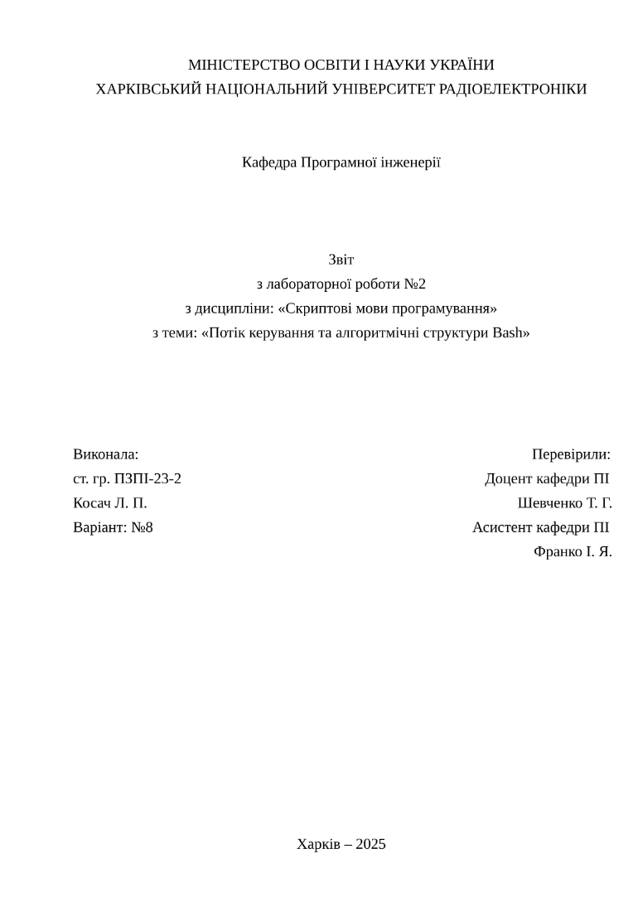

# Шаблон Typst для робіт ХНУРЕ

Пакунок [Typst](https://typst.app) для оформлення лабораторних, практичних і курсових робіт ХНУРЕ за ДСТУ 3008:2015. Ви пишете текст, а титульні сторінки, нумерацію, підписи рисунків і таблиць, перелік джерел та додатки шаблон оформлює сам.



## Що вміє

- Титульні сторінки звітів з лабораторних і практичних робіт (ЛБ, ПЗ, КР, РФ, ІДЗ), два варіанти оформлення.
- Курсова робота і комплексний курсовий проєкт: титулка, завдання, календарний план, реферат з автоматичними підсумками, зміст.
- Оформлення тексту за ДСТУ 3008:2015: поля, шрифт, інтервали, заголовки, нумерація рисунків, таблиць, формул і лістингів за розділами, списки, додатки.
- Таблиці з написами «Продовження таблиці» при переносі на нову сторінку.
- Перелік джерел за ДСТУ 3008:2015 або ДСТУ 8302:2015.
- Короткі `fig`, `tab` і `bib` для рисунків, таблиць і переліку джерел -- див. [Короткі назви](docs/writing.md#короткі-назви).
- Вбудовані дані ХНУРЕ: кафедри, спеціальності, повні назви дисциплін за скороченням. Свої можна додати без правок пакунка.

## Швидкий старт

Потрібні [mise](https://mise.jdx.dev/getting-started.html) і `git`. Typst та все інше mise встановить сам.

```sh
git clone --depth 1 -b 0.3.0 https://github.com/beauloxe/typst-nure-template.git nure-template
cp -r nure-template/template/mise lb1   # Windows (PowerShell): Copy-Item -Recurse nure-template\template\mise lb1
cd lb1
mise trust
mise install
mise run watch
```

Готово: `main.pdf` перезбирається при кожному збереженні. Відкрийте `src/doc.toml`, впишіть свої дані й пишіть текст у `src/main.typ`.

Без mise пакунок можна встановити як звичайний локальний пакунок Typst -- див. [Встановлення](docs/install.md).

## Як виглядає робота

`src/doc.toml` -- дані, що зазвичай не змінюються між роботами з однієї дисципліни:

```toml
subject = "СМП"          # скорочення дисципліни, повна назва підставиться сама
type = "ЛБ"              # ЛБ, ПЗ, КР, РФ, ІДЗ
number = 1

[[authors]]
name = "Косач Л. П."
edu-program = "КУІБ"
group = "24-1"
gender = "f"             # m, f -- для «Виконав»/«Виконала»
variant = 8

[[mentors]]
name = "Шевченко Т. Г."
degree = "Доцент кафедри ПІ"
gender = "m"
```

`src/main.typ` -- сама робота:

```typst
#import "@vendor/nure:0.3.0": *
#import style: spacing

#let w = work(..toml("doc.toml"), title: "Потік керування в Bash")

#set document(..w.document)
#show: style.dstu.with(skip: 1)

#report.title-page(w)
#title-heading(w)

#v(-spacing)
== Мета роботи
Ознайомитися з ...

== Хід роботи
...

== Висновки
...
```

Виходить титульна сторінка, а далі «1 ПОТІК КЕРУВАННЯ В BASH», «1.1 Мета роботи» і так далі, з нумерацією сторінок і оформленням за ДСТУ.

## Документація

| | |
| --- | --- |
| [Встановлення](docs/install.md) | mise, локальний пакунок, налаштування редактора, організація семестру |
| [Лабораторна чи практична](docs/lab.md) | Звіт від титулки до додатків |
| [Курсова](docs/coursework.md) | Курсова робота і комплексний курсовий проєкт |
| [Оформлення тексту](docs/writing.md) | Заголовки, рисунки, таблиці, формули, код, списки, посилання, джерела, додатки |
| [Дані роботи](docs/data.md) | Усі поля `doc.toml`, власні дисципліни й університети |
| [Довідник](docs/reference.md) | Усі функції пакунка |
| [Розширення](docs/extending.md) | Власні сторінки, макети й блоки |
| [Перехід зі старих версій](docs/migration.md) | Для тих, хто писав на 0.1–0.2 |
| [Розробка](docs/development.md) | Структура репозиторію, тести, CI |

Потрібен Typst 0.15 або новіший (mise встановлює потрібну версію сам).

## Подяки

Проєкт продовжує [typst_nure_template](https://github.com/linerds/typst_nure_template). Дякуємо його авторам: unexplrd, Anton Bilous, Sytnyk Yehor, pencelheimer, ilyaoc, dxrknesss, bosiiandgolii, sekomi.

## Ліцензія

[GPL-3.0](LICENSE)
